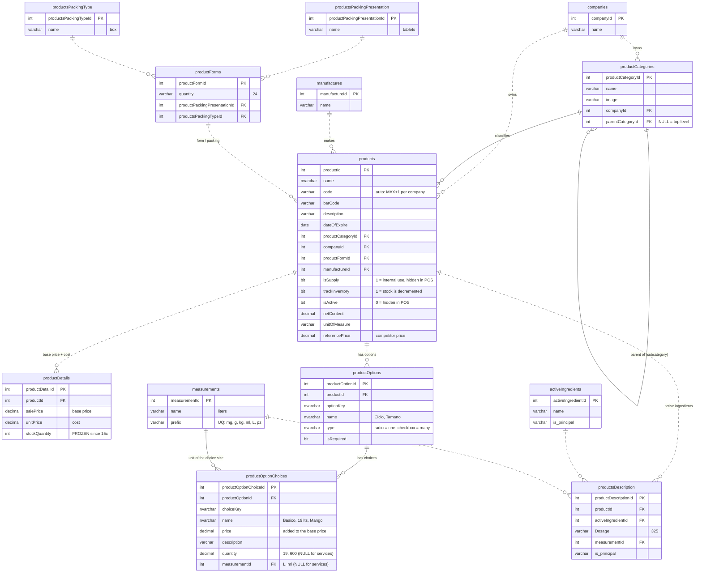
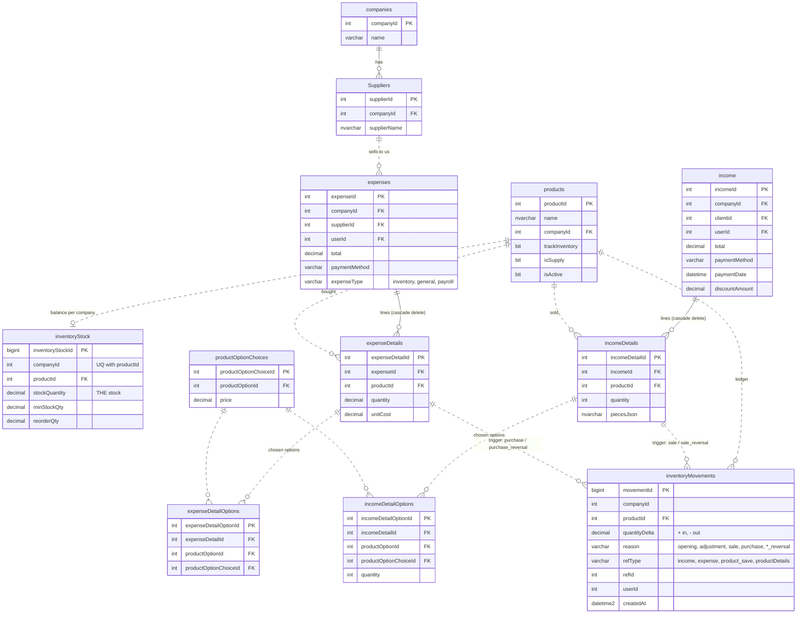

# Products — ER diagram

State after migrations `2026-10-15` → `2026-10-15e`
(`sql/migration_history/migrations/`). Only the product-related tables.

- **Solid line** — foreign key enforced by SQL Server.
- **Dashed line** — relationship by convention only (no FK; the SPs keep it).
- Multi-tenant: every catalog row belongs to one `companyId`.

## 1. Catalog — categories, products, prices, options, description

**Core configuration** (every product type): `productCategories` → `products` →
`productOptions` → `productOptionChoices`, with `measurements` giving each choice
its own size (19 L, 600 ml). **Catalog details** (only when they apply):
`productDetails` (base price, cost), `productsDescription` (pharmaceutical
composition), `productForms` (legacy packing).

**Price of a sold line** = `productDetails.salePrice` (base) + Σ chosen
`productOptionChoices.price` × quantity. Example: Servicio de lavado, base $0 +
Básico $40 = **$40**.

How the examples map (choice-level size):

| Category | Product | Option | Choice | quantity | unit | price |
|---|---|---|---|---|---|---|
| Bebidas | Garrafón | Tamaño | 19 lts | 19 | L | $10 |
| Bebidas | Garrafón | Tamaño | 10 lts | 10 | L | $5 |
| Bebidas | Té Arizona | Sabor | Mango | 450 | ml | $15 |
| Servicios | Servicio de lavado | Ciclo | Básico | — | — | $40 |

A choice is a variant **without its own stock or barcode**. If a size has to be
counted in inventory or scanned at the register, it must be its own product
(own `inventoryStock` row, own `barCode`).

## 2. Inventory, sales and purchases

**Stock rule (phase 1):** `inventoryStock.stockQuantity` is the only stock and
always equals Σ `inventoryMovements.quantityDelta`. Sales and purchases post
movements automatically through `trg_incomeDetails_inventory` /
`trg_expenseDetails_inventory`, only for products with `trackInventory = 1`.

## Notes / known debt

| Item | Status |
|---|---|
| `productDetails.stockQuantity` | Frozen since 15c; read stock from `inventoryStock`. |
| `productDetails` | Several rows per product exist (22 rows / 19 products); SPs use the first by `productDetailId`. |
| `productForms`, `productsPacking*` | Legacy pharmacy packing (1 row each). Not used by the POS. |
| `categories`, `subCategories` | Legacy pharmacy tables, **not part of this model** (left out of the diagram). Subcategories live in `productCategories.parentCategoryId`. |
| `one_products` | Reads non-existent `product_details` / `product_options` tables — dead SP. |
| `products.netContent` / `unitOfMeasure` | Size of the base product itself (free-text unit). Kept; candidates to become `measurementId` once validated against the choices. |
| `productForms` direction | Stays `products.productFormId → productForms` (many products share one form); not flipped to `productForm.productId`. |
| Dashed relationships | No FK in SQL Server; adding FKs is a candidate follow-up once data is verified clean. |
