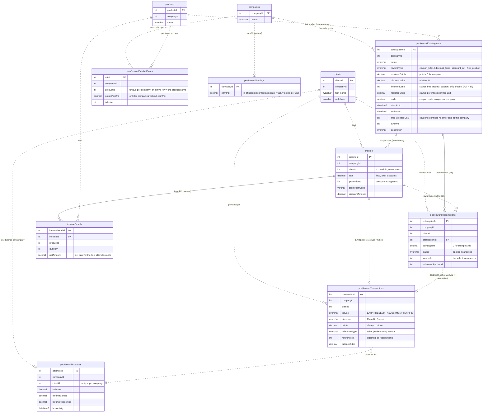

# POS rewards & promotions — ER diagram

State after `2026-10-16c` (catalog becomes the single discount table) and
`2026-10-16d` (drops `promotions` + `promotionTargets`). Background:
[promotions_rewards_analysis.md](promotions_rewards_analysis.md).

- **Solid line**: foreign key enforced by SQL Server.
- **Dashed line**: relationship by convention only (no FK; the SPs keep it).
- Multi-tenant: every row carries `companyId`.

## How many tables

| | Tables |
|---|---|
| **Rewards & promotions (6)** | `posRewardCatalogItems`, `posRewardProductRates`, `posRewardSettings`, `posRewardBalances`, `posRewardTransactions`, `posRewardRedemptions` |
| Existing tables they use (5) | `companies`, `clients`, `products`, `income`, `incomeDetails` |
| **Dropped (2)** | `promotions`, `promotionTargets`. Their coupon now lives in `posRewardCatalogItems` (`rewardType = 'coupon_b2g1'`) |

There is one catalog for every discount:

| `rewardType` | What it is | Paid with | Applied |
|---|---|---|---|
| `coupon_b2g1` | 2x1 coupon (buy 2, pay 1 per line), typed at checkout (`code`) | nothing; rules: dates, `firstPurchaseOnly` (no other sale at this company) | with the sale |
| `discount_fixed` / `discount_pct` | $ / % off | points balance (`requiredPoints`) | with the sale |
| `free_product` | stamp card: buy N of a product, the next one is free | purchases of `freeProductId` (`requiredUnits`) | with the sale |

## Diagram

## Flow of one sale

1. The POS sends `POST /income` with `promotionCode` and/or `rewardCatalogItemIds` (one reward).
2. `sp_income` saves the sale. `modules/income.py` has removed the coupon and reward from that payload first.
3. `sp_income_applyDiscounts`, in one transaction under the client lock:
   - checks the coupon and the reward against `posRewardCatalogItems`;
   - writes a `posRewardRedemptions` row with `incomeId`;
   - for a points reward, writes a `REDEEM` row and debits `posRewardBalances`;
   - sets `income.total`, `discountAmount`, and `promotionId`/`promotionCode`.
4. `sp_posRewardTransactions_earnFromTicket` writes an `EARN` row and credits `posRewardBalances`.
   - **With `posRewardSettings.earnPct`** (GMO Lavandería: 2.5%): it earns that % of the net paid on eligible lines, `incomeDetails.netAmount`. 1 point = $1, so the rewards are $10 for 10 pts, $25 for 25 and $50 for 50.
   - **Without it:** `pointsPerUnit` × paid units.
   - Either way, only products with an active rate earn, and free units earn nothing.

Stamp-card progress isn't stored anywhere. One function computes it,
`fn_posRewardStampStatus`, and every SP that shows or redeems a stamp card uses it:
units of `freeProductId` bought at the company, minus the free units given in sales,
minus applied redemptions × `requiredUnits`. Cancelled redemptions consume nothing.
Free units earn no points.

## Integrity rules (2026-10-18)

- **One lock per client:** `sp_income_applyDiscounts` and `sp_posRewardRedemptions_redeem`
  check and consume points or stamps under one per-client lock (`sp_getapplock`).
  Points are debited with `balance >= requiredPoints` in the same `UPDATE`.
- **One reward per sale:** filtered unique index `UQ_posRewardRedemptions_income_applied`.
- **Deleting a sale:**
  - `sp_posRewardRedemptions_reverseForIncome` cancels the sale's redemption and credits its points back (`ADJUSTMENT`/C);
  - then `sp_income_reverseOnDelete` takes back the points the sale earned.
  - Nothing is deleted.
- **CHECK constraints:**
  - catalog values per `rewardType` and validity dates;
  - rate ≥ 0;
  - balance ≥ 0;
  - ledger points > 0 and `txType`/`direction` pairs;
  - `pointsSpent` ≥ 0.

## Not part of this

Loan-behaviour rewards (`rewardTransactions`, `rewardPoints`, `rewardRules`, `rewardBenefits`,
`modules/rewards.py`) are a separate system. They share no FK, endpoint or conversion
with POS rewards.
